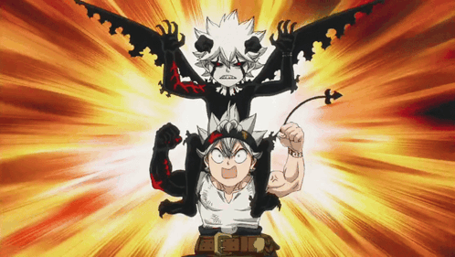

  

<h1 align="center">
  
</h1>

<h3 align="center">A passionate Full-Stack & Mobile Developer — fascinated by AI 🤖</h3>
---

## 💫 About Me

<table align="center">
<tr border="none">
<td width="55%" align="left">

- 🔨 I'm currently working on **My 3D Interactive Portfolio (React + Three.js + GSAP)**

- 👥 I'm looking to collaborate on **Full-stack web apps, AI projects & open source**

- 🌱 I'm currently learning **TypeScript, Next.js & Machine Learning**

- 🤖 I'm deeply interested in **Artificial Intelligence, Deep Learning & AI-powered apps**

- 💬 Ask me about **React.js, Laravel, Node.js, Flutter, PHP, Docker**

- 🎓 Student at **ENSA Safi — Génie Informatique & IA**

- 📫 How to reach me: **o.belfassi7993@uca.ac.ma**

- 📍 Based in **Marrakech, Morocco**

- ⚡ Fun fact: **I turn coffee into clean code — and bugs into features 😄**

</td>
<td width="45%" align="center">
  
</td>
</tr>
</table>

---

## 🍀 The Five-Leaf Clover

  

 

<table align="center">
  <tr>
    <td align="center" width="20%">🍀 <b>1st Leaf</b> Faith</td>
    <td align="center" width="20%">🍀 <b>2nd Leaf</b> Hope</td>
    <td align="center" width="20%">🍀 <b>3rd Leaf</b> Love</td>
    <td align="center" width="20%">✨ <b>4th Leaf</b> Good Luck</td>
    <td align="center" width="20%">😈 <b>5th Leaf</b> A Demon</td>
  </tr>
</table>

 

---

## 🌐 Connect With Me

  
  &nbsp;&nbsp;
  
  &nbsp;&nbsp;
  
  &nbsp;&nbsp;
  

---

## 🛠️ Tech Stack

### 🎨 Frontend

  

### ⚙️ Backend

  

### 📱 Mobile

  

### 🗄️ Databases

  

### 💡 Languages

  

### 🤖 AI & Machine Learning

  

### 🔧 Tools & DevOps

  

---

## 🧠 My AI Journey

<table align="center">
  <tr>
    <td align="center" width="25%">
      <h3>📈 Machine Learning</h3>
      Regression, classification, model evaluation & data preprocessing
    </td>
    <td align="center" width="25%">
      <h3>🧬 Deep Learning</h3>
      Neural networks with TensorFlow & PyTorch
    </td>
    <td align="center" width="25%">
      <h3>👁️ Computer Vision</h3>
      Image processing & recognition with OpenCV
    </td>
    <td align="center" width="25%">
      <h3>💬 AI-Powered Apps</h3>
      Integrating LLMs & ML models into real products
    </td>
  </tr>
</table>

---

## 🏆 GitHub Achievements 
  

---

## 🚀 Featured Projects

<table align="center">
  <tr>
    <td align="center" width="50%">
      <h3>🌐 3D Interactive Portfolio</h3>
      
Personal portfolio with Three.js 3D models, GSAP animations, dark mode & Laravel contact API

      

      
    </td>
    <td align="center" width="50%">
      <h3>🛒 PHP MVC E-commerce Platform</h3>
      
Secure e-commerce app with Google OAuth 2.0, password reset, product management & Docker deployment

      

      
    </td>
  </tr>
  <tr>
    <td align="center" width="50%">
      <h3>📊 Interactive Dashboard</h3>
      
Real-time data visualization and management dashboard built with Canvas API

      

      
    </td>
    <td align="center" width="50%">
      <h3>🔐 Secure Auth System</h3>
      
Full-stack authentication with user management, validation & SQL injection / XSS protection

      

      
    </td>
  </tr>
</table>

---

## 📊 GitHub Stats

  
    
  
    
  
  &nbsp;
  

---

  

---

### ✍️ Random Dev Quote

  

---

  <b>💼 Open to internships & collaborations — Let's build something amazing together!</b>
    
  <i>⭐ Feel free to explore my repos and leave a star if you find something useful!</i>

